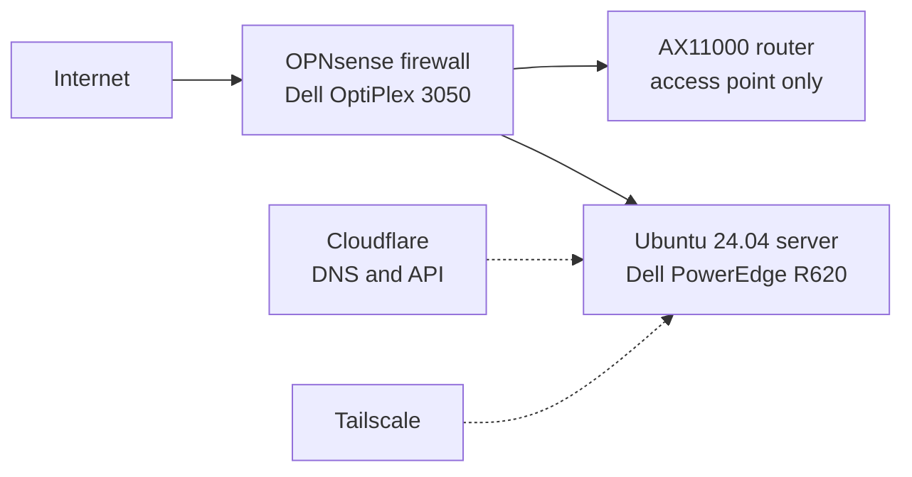

# Home Network and Server Lab

My home network and Linux server. Everything here is a personal project that I built and run myself. The network has been running since October 2026.

> No IP addresses, tokens, or config exports are published in this repo.

## Network overview

## Firewall and router
- Replaced a consumer AX11000 router with **OPNsense** on a repurposed **Dell OptiPlex 3050**.
- Wrote the firewall rules myself.
- The AX11000 was kept as a Wi-Fi access point.
- The OPNsense admin panel has a certificate and is reachable only from inside the home network.

## Domain, DNS, and remote access
- My own domain is managed through **Cloudflare** (DNS), with Cloudflare API access used for routing traffic to the server through the network.
- **Tailscale** gives me SSH and remote desktop access to the server from outside the house, without opening ports for it.

## Server: Dell PowerEdge R620, Ubuntu 24.04
- **Jellyfin** media server behind an **nginx reverse proxy** with a **Let's Encrypt** certificate (replaced Plex).
- **Home Assistant** in a **KVM** virtual machine on a bridged network interface.
- **Docker** services.
- Game servers managed with CubeCoders AMP.

## Troubleshooting write-up: lag on a modded Minecraft server
- **Symptom:** the server kept stalling.
- **Investigation:** Spark profiler data and per-process memory use showed four game servers competing for the same RAM.
- **Fix:** pinned the two heaviest game servers to separate NUMA nodes with `taskset`.
- **Result:** swap went from 3.8 GB to 780 KB and the longest tick from 3,980 ms to 932 ms.

## Other things I use this for
- Daily use of the terminal on both the server and my Kubuntu desktop (Ryzen 9 3900XT, RTX 3080).
- Fixing problems along the way, such as Steam freezes traced to NTFS game drives and fixed by reformatting to ext4.
